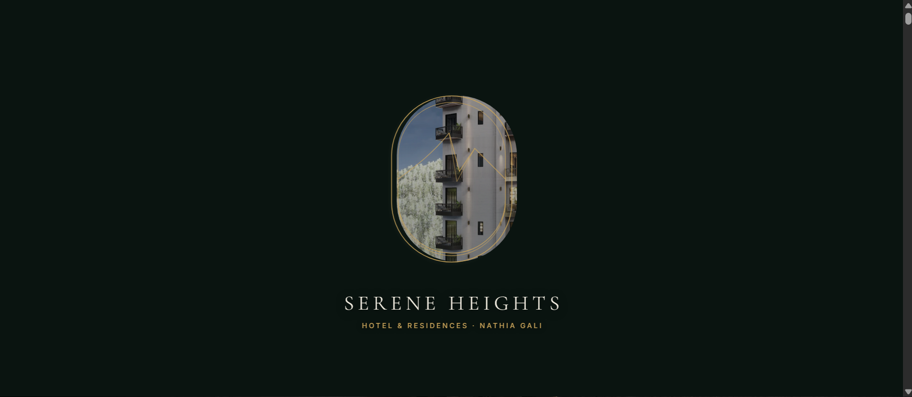
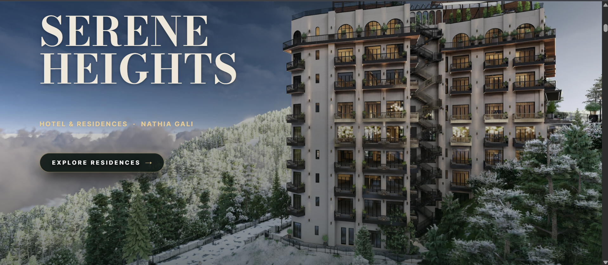
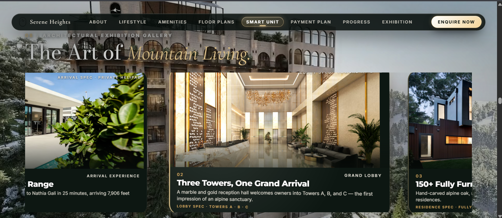
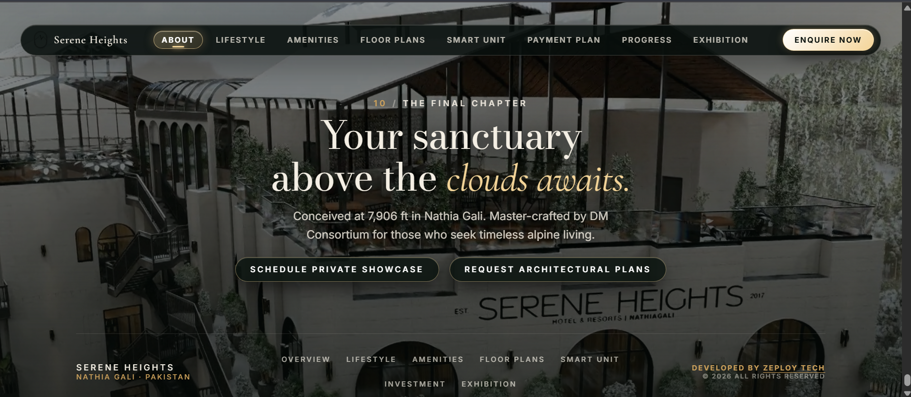

<div align="center">

# SERENE HEIGHTS

<p align="center">
  
  
  <br>
  
  
</p>

### A Cinematic 3D Luxury Hospitality Experience

<p>
  <strong>Hotel & Resorts · Nathiagali, Pakistan</strong>
</p>

<p>
  A scroll-driven digital experience combining architectural storytelling,
  cinematic video, WebGL, 3D interaction, and editorial luxury design.
</p>

<br>

<a href="https://serene-heights-3d-web.vercel.app">
  
</a>

<a href="https://github.com/syedasjadabbas/serene-heights-3d-web">
  
</a>

<br><br>


</div>

<br>

---

# The Experience

Serene Heights is a premium digital experience designed around one idea:

> The website should feel like moving through the property itself.

Instead of presenting the resort through conventional website sections, the experience uses scroll, depth, camera movement, cinematic video, architecture, and WebGL to create a continuous visual journey.

The interface combines:

**Luxury hospitality + architecture + 3D + cinematic motion + editorial design**

---

# Visual Direction

<div align="center">

|                                |                                |
| ------------------------------ | ------------------------------ |
| **Dark Forest / Navy**         | **Warm Champagne Gold**        |
| Deep architectural backgrounds | Restrained luxury accents      |
| **Bodoni Moda**                | **Cormorant Garamond**         |
| Editorial display typography   | Elegant supporting typography  |
| **Architectural Photography**  | **Cinematic Mountain Imagery** |
| Large compositions             | Atmospheric depth              |

</div>

The visual system intentionally avoids generic SaaS layouts, excessive gradients, noisy interfaces, and conventional card-heavy presentation.

Architecture remains the visual focus.

---

# Cinematic Journey

The experience progresses as one continuous visual timeline:

```text
                    SERENE HEIGHTS
                          │
                          ▼
                    CINEMATIC HERO
                          │
                          ▼
                 OWNERSHIP / INVESTMENT
                          │
                          ▼
                     MASTERPLAN
                          │
                          ▼
                3D SANCTUARY VIEWER
                          │
                          ▼
                 AMENITIES / INVESTMENT
                          │
                          ▼
                ARCHITECTURAL GALLERY
                          │
                          ▼
                 INTERACTIVE 3D STAGE
                          │
                          ▼
                 FOUR-SEASON EXPERIENCE
                          │
                          ▼
                CURATED ARCHITECTURAL
                       GALLERY
                          │
                          ▼
                   FINAL CTA / FOOTER
```

There are no artificial visual resets between major moments.

The goal is to make the entire page feel like one continuous scene.

---

# 01 · Cinematic Hero

The Hero is the primary cinematic entry point.

### Hero sequence

```text
Page Load
    ↓
Navigation Reveal
    ↓
Headline Reveal
    ↓
Architecture Appears
    ↓
Scroll
    ↓
Camera Push
    ↓
Depth Separation
    ↓
Parallax
    ↓
Architectural Reveal
    ↓
Cinematic Transition
    ↓
Section 2
```

The Hero combines:

* Cinematic architectural composition
* Scroll-driven camera movement
* Editorial typography
* Atmospheric depth
* Parallax
* Video-based deconstruction
* Responsive behaviour
* Premium navigation

---

# 02 · Hero Deconstruction

The Hero-to-Section-2 transition uses a scroll-controlled cinematic sequence.

Instead of treating the video as a normal background video, the implementation maps scroll progress to the cinematic sequence.

```text
Scroll Progress
       │
       ▼
┌──────────────────┐
│  Cinematic Video │
└──────────────────┘
       │
       ▼
Architectural State
       │
       ▼
Section 2
```

The scrub system uses:

* `requestAnimationFrame`
* Pending progress tracking
* Seeking protection
* Metadata readiness checks
* Controlled `currentTime` updates
* ScrollTrigger synchronization

The architecture is designed to avoid unnecessary video seeking during rapid scrolling.

---

# 03 · Ownership / Investment

The second section continues directly from the Hero's final architectural state.

The design focuses on:

* Property ownership
* Investment narrative
* Architectural integration
* Editorial typography
* Layered content
* Spatial composition
* Controlled transparency

The architecture acts as the stage.

Content supports the environment instead of covering it.

---

# 04 · Masterplan

The Masterplan transforms architectural information into a scroll-driven journey.

```text
Scroll
  ↓
Journey Line
  ↓
Node 01
  ↓
Journey Continues
  ↓
Node 02
  ↓
Journey Continues
  ↓
Node 03
```

The journey is the dominant interaction.

Supporting content introduces:

* Architectural imagery
* Depth
* Spatial cards
* Image movement
* Editorial typography
* Blueprint-inspired details

---

# 05 · 3D Sanctuary

The Sanctuary experience introduces genuine interactive 3D.

### Technology

```text
Three.js
WebGL
React
TypeScript
```

The 3D experience is designed around architectural presentation rather than a conventional product configurator.

The viewer becomes one of the major visual moments of the website.

---

# 06 · Amenities & Investment

A cinematic presentation of the property's amenities and investment proposition.

The composition uses:

* Large imagery
* Editorial typography
* Depth
* Spatial movement
* Supporting information
* Premium card treatment

---

# 07 · Architectural Horizontal Gallery

Vertical scrolling controls horizontal movement.

```text
Vertical Scroll
       ↓
Scroll Progress
       ↓
Horizontal Gallery
       ↓
Image Parallax
       ↓
Architectural Exhibition
```

Each image receives independent movement to create depth inside the gallery.

---

# 08 · Interactive 3D Stage

The Interactive 3D Stage combines:

* WebGL
* Three.js
* GSAP
* ScrollTrigger
* Camera movement
* Architectural depth
* Scroll choreography

The section is also one of the heavier runtime areas, so rendering is controlled according to visibility.

---

# 09 · Four Seasons

The Four-Season experience introduces environmental storytelling.

Visual systems include:

* Seasonal imagery
* Atmospheric overlays
* Particle systems
* Season navigation
* Micro-interactions
* Scroll transitions
* Environmental depth

The visual identity remains consistent while the atmosphere changes.

---

# 10 · Curated Architectural Gallery

The gallery uses an exhibition-style composition rather than a conventional image grid.

Interactions include:

* Image parallax
* Mouse tilt
* Scale transitions
* Architectural photography
* Editorial typography
* Spatial composition

The goal is to present the property like a curated architectural collection.

---

# 11 · Final Cinematic CTA

The experience concludes with a fullscreen mountain scene.

```text
SERENE HEIGHTS

Hotel & Resorts
Nathiagali

Stay
Dining
Experiences
Gallery
About
Contact
```

The final section uses a dedicated background MP4 optimized for web playback.

---

# Motion System

The website uses a coordinated motion architecture.

```text
                    USER SCROLL
                         │
                         ▼
                      LENIS
                         │
                         ▼
                  SCROLL PROGRESS
                         │
                         ▼
                    SCROLLTRIGGER
                         │
              ┌──────────┼──────────┐
              ▼          ▼          ▼
             GSAP      VIDEO      THREE.JS
              │          │          │
              ▼          ▼          ▼
            DOM       SCRUB      CAMERA /
          MOTION      FRAME       3D STATE
              │          │          │
              └──────────┼──────────┘
                         ▼
                 CINEMATIC OUTPUT
```

### Lenis

Provides smooth scrolling.

### GSAP

Controls animation timelines and spatial movement.

### ScrollTrigger

Coordinates scroll progress, pinning, scrubbing, and section choreography.

### Three.js

Handles genuine 3D scenes and WebGL rendering.

### HTML5 Video

Provides cinematic frame-based transitions.

---

# Performance Engineering

A major engineering challenge is running multiple expensive systems inside one continuous experience.

```text
Lenis
  +
GSAP
  +
ScrollTrigger
  +
Video Scrubbing
  +
Three.js
  +
WebGL
  +
Large Images
  +
Pinned Sections
```

The goal is not to remove the visual experience.

The goal is to make the existing experience responsive.

Current optimization areas include:

* Main-thread workload
* Scroll responsiveness
* GSAP execution
* ScrollTrigger updates
* Lenis RAF work
* Video `currentTime` writes
* Video seeking
* Three.js render loops
* Canvas visibility
* React re-renders
* Event listeners
* Asset loading
* Bundle size
* Code splitting
* Lazy loading

---

# Cinematic Video Pipeline

The Hero deconstruction video was originally produced at:

```text
2560 × 1440
~85 MB
~85 Mbps
24 FPS
192 frames
GOP 1
```

A web-optimized version was produced at:

```text
1920 × 1080
H.264
CRF 18
GOP 1
YUV 4:2:0
Fast Start
~35 MB
```

### Why GOP 1?

The Hero sequence is used for scroll scrubbing.

The browser needs to move between visual positions quickly.

Using an I-frame-heavy structure makes frame access more suitable for this interaction than a conventional long-GOP streaming video.

---

# Section 10 Video Optimization

The final mountain video originally had the MP4 metadata at the end of the file.

The file was optimized with:

```bash
ffmpeg -i input.mp4 \
  -c copy \
  -movflags +faststart \
  output.mp4
```

This allows browsers to access the MP4 metadata earlier during loading.

---

# Visibility-Aware WebGL

Multiple sections use WebGL.

Rendering every scene continuously would waste resources when the scene is outside the viewport.

The project therefore uses visibility-aware rendering:

```text
┌──────────────┐
│   IN VIEW    │
│              │
│  Render 3D   │
│     ✓        │
└──────────────┘

       ↓

┌──────────────┐
│  OFFSCREEN   │
│              │
│ Reduce/Pause │
│   Rendering  │
└──────────────┘
```

This helps reduce unnecessary CPU and GPU work.

---

# Responsive Experience

The website is designed for desktop and mobile.

Responsive considerations include:

* Adaptive navigation
* Mobile menu
* Safe-area support
* Responsive typography
* Responsive imagery
* Responsive WebGL canvases
* Touch interaction
* Pinned section behaviour
* Video behaviour
* Browser zoom

Tested zoom levels include:

```text
80%
90%
100%
110%
```

---

# Architecture

```text
┌────────────────────────────────────────────────────────────┐
│                    SERENE HEIGHTS                          │
├────────────────────────────────────────────────────────────┤
│                                                            │
│  React Application                                         │
│                                                            │
│  ┌───────────────┐    ┌───────────────────────────────┐   │
│  │ Navigation    │    │ Content Sections              │   │
│  └───────────────┘    │                               │   │
│                       │ Hero                          │   │
│                       │ Deconstruction                │   │
│                       │ Ownership                     │   │
│                       │ Masterplan                    │   │
│                       │ 3D Sanctuary                  │   │
│                       │ Amenities                     │   │
│                       │ Horizontal Gallery            │   │
│                       │ 3D Stage                      │   │
│                       │ Four Seasons                  │   │
│                       │ Architectural Gallery         │   │
│                       │ Final CTA                     │   │
│                       └───────────────────────────────┘   │
│                              │                             │
│              ┌───────────────┼───────────────┐             │
│              ▼               ▼               ▼             │
│           Lenis            GSAP          Three.js          │
│              │               │               │             │
│              └───────────────┼───────────────┘             │
│                              ▼                             │
│                       ScrollTrigger                       │
│                              │                             │
│                     Cinematic Timeline                    │
│                                                            │
└────────────────────────────────────────────────────────────┘
```

---

# Project Structure

```text
serene-heights-3d-web/
│
├── public/
│   └── media/
│       └── serene-heights/
│           └── hero/
│               └── deconstruction/
│
├── src/
│   ├── assets/
│   │   └── videos/
│   │
│   ├── components/
│   │   ├── HeroV2/
│   │   ├── Deconstruction/
│   │   ├── SectionTwo/
│   │   ├── SectionThree/
│   │   ├── SectionFour/
│   │   ├── SectionFive/
│   │   ├── SectionSix/
│   │   ├── SectionSeven/
│   │   ├── SectionEight/
│   │   ├── SectionNine/
│   │   ├── SectionTen/
│   │   └── Navigation/
│   │
│   ├── hooks/
│   │
│   ├── styles/
│   │
│   ├── App.tsx
│   └── main.tsx
│
├── docs/
│   ├── screenshots/
│   │   ├── hero.webp
│   │   ├── section-2.webp
│   │   ├── section-3.webp
│   │   ├── section-5.webp
│   │   ├── four-seasons.webp
│   │   ├── gallery.webp
│   │   └── footer.webp
│   │
│   └── gifs/
│       ├── full-experience.gif
│       ├── hero-deconstruction.gif
│       ├── 3d-sanctuary.gif
│       ├── horizontal-gallery.gif
│       └── interactive-stage.gif
│
├── package.json
├── tsconfig.json
├── vite.config.ts
└── README.md
```

---

# Tech Stack

<div align="center">

| Technology            | Purpose                             |
| --------------------- | ----------------------------------- |
| **React**             | Component architecture              |
| **TypeScript**        | Type-safe development               |
| **Vite**              | Development and production bundling |
| **GSAP**              | Animation timelines                 |
| **ScrollTrigger**     | Scroll choreography                 |
| **Lenis**             | Smooth scrolling                    |
| **Three.js**          | 3D/WebGL experiences                |
| **React Three Fiber** | React-based 3D integration          |
| **Drei**              | Three.js utilities                  |
| **FFmpeg**            | Video processing                    |
| **CSS Modules**       | Scoped styling                      |
| **Vercel**            | Production deployment               |

</div>

```

---

# Production Workflow

Every meaningful performance change follows:

```text
Measure
   ↓
Identify Bottleneck
   ↓
Smallest Correct Fix
   ↓
TypeScript
   ↓
Production Build
   ↓
Localhost Test
   ↓
Vercel Test
   ↓
Measure Again
   ↓
Visual Regression Check
```

Performance improvements are accepted only when the experience itself improves.

---

# Design Principles

### 01 · Architecture First

The property should remain the dominant visual element.

### 02 · Motion With Purpose

Animation should communicate depth, scale, progression, or transition.

### 03 · Continuous Timeline

Major sections should feel connected rather than visually isolated.

### 04 · Controlled Luxury

Effects should remain restrained.

### 05 · Editorial Typography

Typography should create hierarchy and rhythm.

### 06 · Spatial Interaction

Images and content should occupy depth rather than behave like flat blocks.

### 07 · Performance Matters

The cinematic experience should remain responsive.

---

# Current Status

<div align="center">

| Area                     | Status |
| ------------------------ | :----: |
| Project Foundation       |    ✅   |
| Navigation               |    ✅   |
| Cinematic Hero           |    ✅   |
| Hero Deconstruction      |    ✅   |
| Section 2                |    ✅   |
| Section 3                |    ✅   |
| Section 4 3D             |    ✅   |
| Section 5                |    ✅   |
| Section 6                |    ✅   |
| Section 7                |    ✅   |
| Section 8                |    ✅   |
| Section 9                |    ✅   |
| Section 10               |    ✅   |
| Responsive Pass          |    ✅   |
| Production QA            |    ✅   |
| Vercel Deployment        |    ✅   |
| Performance Optimization |   🔄   |

</div>

### Current Engineering Focus

The current phase is focused on runtime performance.

Primary targets:

```text
Hero video scrubbing
        ↓
Scroll responsiveness
        ↓
GSAP / ScrollTrigger workload
        ↓
Lenis
        ↓
Three.js rendering
        ↓
React rendering
        ↓
Asset loading
        ↓
Bundle loading
```

The objective is to improve responsiveness without removing the experience.

---

# Live

<div align="center">

## Experience Serene Heights

<a href="https://serene-heights-3d-web.vercel.app">
  
</a>

<br><br>

<strong>Hotel & Resorts · Nathiagali</strong>

<br><br>

<a href="https://github.com/syedasjadabbas/serene-heights-3d-web">GitHub</a>
  ·   <a href="https://serene-heights-3d-web.vercel.app">Live Website</a>

</div>

---

<div align="center">

### SERENE HEIGHTS

<sub>Above the ordinary.</sub>

<br><br>

<sub>
Designed around architecture.  
Built around motion.  
Experienced through space.
</sub>

</div>
